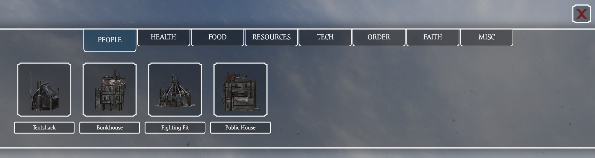

Buildings can be built by the [governing](../Factions/Voting.md) faction. Building menu can be by default opened with `N` key.

Hover over a building to see its description, resource costs and a short placement diagnostic. Inside an established territory, construction uses only a [resource depot](Resource%20Depot.md) in that same territory. Founding a new settlement uses loose resources near your character instead. See [Creating a settlement](Settlements.md) for founding, spacing and resource rules.

Once you select building to build, hologram of selected building will appear. You can rotate the hologram with your mouse wheel. Keep in mind that the hologram cannot be blocked or overlapped by any building, player, or immovable object.

## Repairing buildings

Snowfall wears down some buildings over time. Look at a building to check its condition. Members of the governing faction can repair these buildings when they are **Worn**, **Damaged**, or **Badly Damaged**.

Hold a hammer, stand close to the building, and use **Repair Building**. The nearest [resource depot](Resource%20Depot.md) in the building's territory must have at least **1 processed wood**. Completing the action consumes that wood and restores the building to full health.
