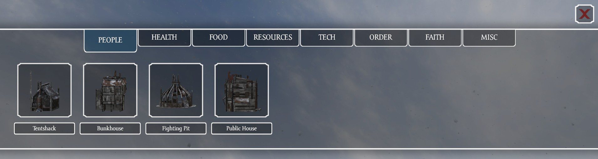

Buildings can be built by the [governing](../Factions/Voting.md) faction. Building menu can be by default opened with `N` key.

Hover over a building to see its description, resource costs and a short placement diagnostic. Inside an established territory, construction uses only a [resource depot](Resource%20Depot.md) in that same territory. Founding a new settlement uses loose resources near your character instead. See [Creating a settlement](Settlements.md) for founding, spacing and resource rules.

Once you select building to build, hologram of selected building will appear. You can rotate the hologram with your mouse wheel. Keep in mind that the hologram cannot be blocked or overlapped by any building, player, or immovable object.

## Snowfall damage

Snowfall wears down buildings that are subject to environmental stress. Heavier snowfall causes more damage, and some buildings wear down faster than others. The resilience upgrade reduces snowfall damage.

## Ruined buildings

When a building becomes **Ruined**, running machinery shuts down. Ruined generators cut power to connected buildings, and heat from ruined buildings fades as they cool.

Some services also become unavailable. You can no longer rest at a ruined Medical Post, create garden plots in a ruined Hothouse, or add coal to a ruined heater. You can repair a damaged building before it becomes ruined.

## Repairing buildings

Look at a building to check its condition. Any player can repair buildings subject to environmental stress when they are **Worn**, **Damaged**, or **Badly Damaged**.

Hold a hammer, stand close to the building, and use **Repair Building**. Keep processed wood on the ground near your character. Completing the action consumes wood from the ground and restores the building to full health.
