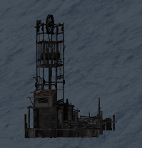

The Coal Mine produces coal  while the [generator](generator.md) in its territory is running. To start the mine, climb the ladder to the control room and use **Turn On**.

Use **Mine Coal** at the pile behind the mine with a pickaxe or icepick. The pile replenishes while the mine is running.
