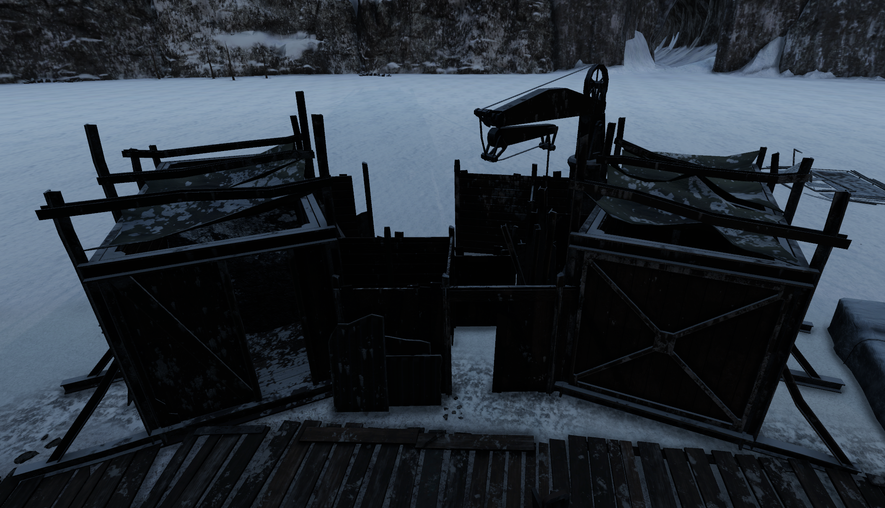
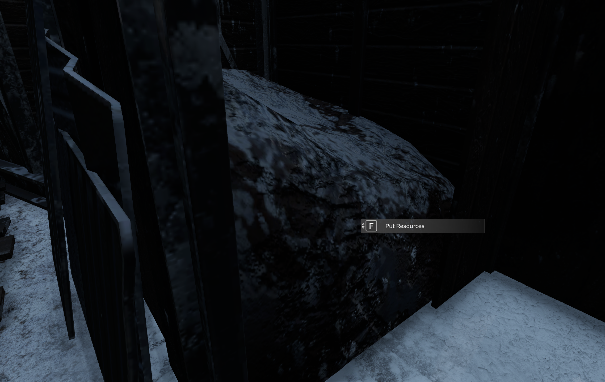
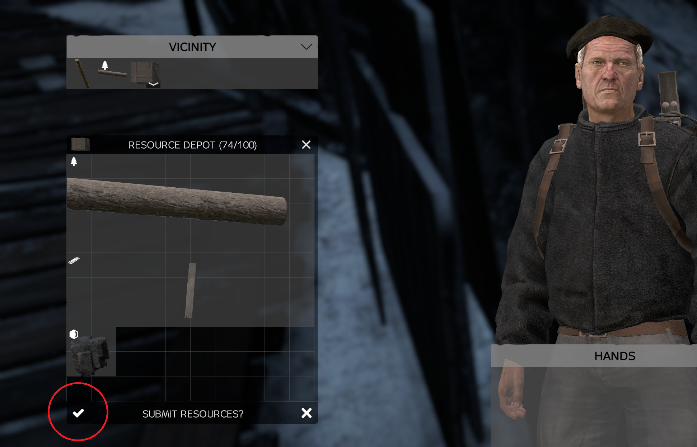

The Resource Depot is the place to store [resources](../Resources/Resources.md).

In order to deposit [resources](../Resources/Resources.md) player must walk up to the right spots and use the action to open the deposit window.

Player can then place [resources](../Resources/Resources.md) into the invenory of the depot and click the submit button. Once submitted, player receives reward in form of heat stamps.

Resources for [building](Basics.md) and resource-paying [upgrades](Upgrades.md) are taken only from a depot inside the building's territory. Nearby loose resources and depots in another territory cannot supplement the cost. Founding a new settlement uses nearby loose resources instead; see [Creating a settlement](Settlements.md).

The [generator](generator.md) also uses depot coal while it is running.

The [Charcoal Kiln](kiln.md) automatically withdraws 1 Raw Wood from its nearest depot and deposits 4 Coal into the same depot every minute while running.

