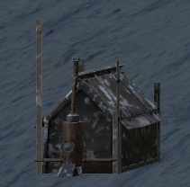
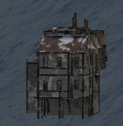
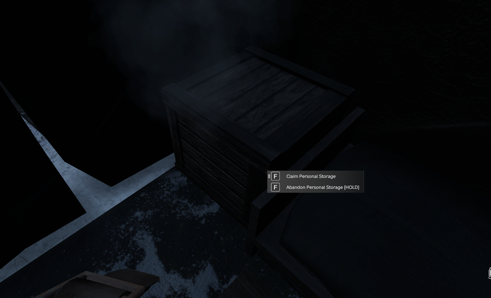
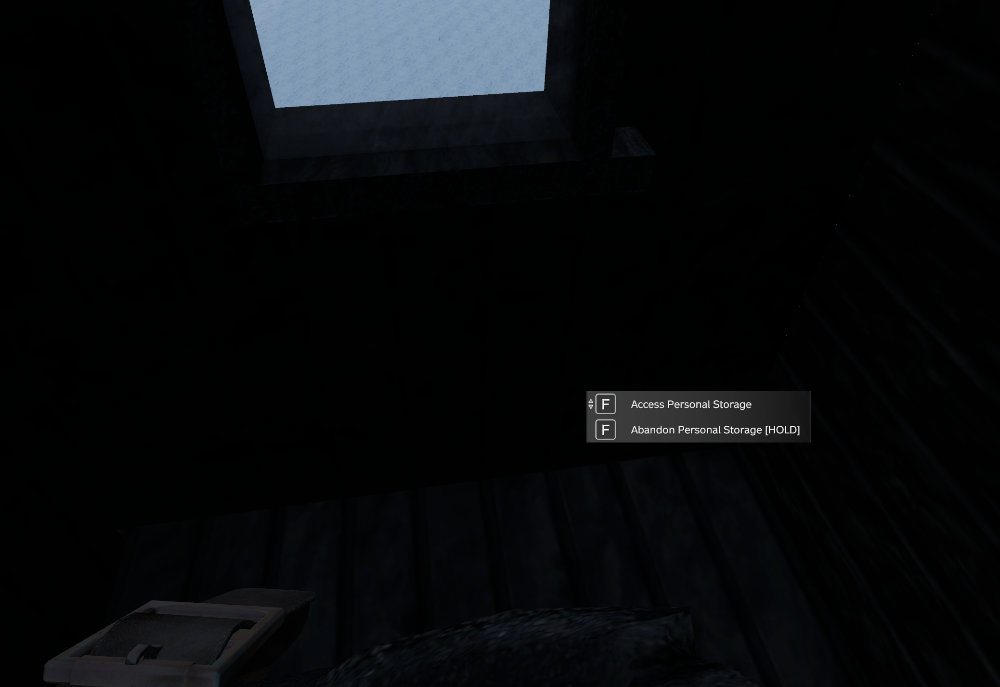

Both Tentshack and Bunkhouse are places to rest and store your personal belongings. There is limited amount of people who can claim said buildings as their home and use personal storage.

In order to get personal storage player must be granted permission from the [governing](../Factions/Voting.md) faction. Once permission is granted, player can walk up to the crate in the Tentshack or one of the rooms in the Bunkhouse and claim storage via the action. This provides options to access your storage or if not needed, abandon it.

#### Tentshack Upgrades

Install [upgrades](Upgrades.md) to improve your Tentshack.

| Upgrade | Cost | Benefit | Requires |
| --- | --- | --- | --- |
| Storage | 3 Processed Wood | Unlocks personal storage for up to 10 inhabitants. | None |
| Heating | 4 Processed Metal | Unlocks automatic heating whenever the territory's generator is running. | None |
| Insulation | 4 Fabric | Adds 1 heat level while Heating is installed and powered. | None |
| Improved Heating | 6 Processed Metal | Adds 1 heat level while Heating is powered. | Heating |

With Heating installed, the Tentshack warms up automatically at any running [generator](generator.md) level. It starts at 1 heat level, plus the generator bonus and installed heat upgrades. Insulation can be installed on its own, with its warmth bonus taking effect once Heating is installed and powered. Heating adds zero coal use.

#### Bunkhouse Upgrades

The Bunkhouse uses [generator](generator.md) heating and already provides personal storage. It starts at 2 heat levels, plus the generator bonus and installed heat upgrades.

| Upgrade | Cost | Benefit |
| --- | --- | --- |
| Insulation | 4 Fabric | Adds 2 heat levels while powered. |
| Improved Heating | 6 Processed Metal | Adds 1 heat level while powered. |

Both upgrades can be installed independently, and their benefits combine while the generator is heating the building.
