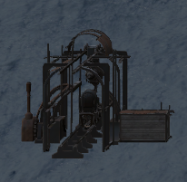

The Wall Drill produces raw wood . Players with the Machine Operator skill can start and operate it. The drill draws **one coal per minute** from the nearest [Resource Depot](Resource%20Depot.md) and shuts down if it runs out of fuel.

