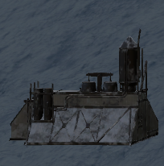

Use the Hothouse to grow crops and collect fresh water. Close the door promptly. Leaving it open for **two minutes** spoils the crops. If the [generator](generator.md) stops, crops stop growing and spoil after **five minutes** without power.

### Farming

The Hothouse has garden plots where you can grow crops.

1. **Fertilize** the plot. This step is optional, but well worth it.
2. **Plant** your seeds.
3. **Water** the crops and keep the Hothouse warm while they grow.
4. **Harvest** the crops once they are fully grown.

**Fertilizer** comes in several qualities. Better fertilizer makes crops grow faster and gives a bigger harvest. Fertilize the plot fully **before** you plant: it only takes effect for seeds planted afterwards.

How much you harvest also depends on your [skills](../Skills/Basics.md). Crops that can be replanted always give you enough to plant them again.

### Compost

The Compost [upgrade](Upgrades.md) costs **6 Processed Wood** and adds a workbench for preparing fertilizer. Fertilizer helps crops grow faster and increases yield.
