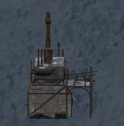

The Charcoal Kiln converts Raw Wood into Coal while the [generator](generator.md) in its territory is running.

Close both kiln doors, then use **Turn On** at the valve. Use **Turn Off** at the valve to stop production. The doors remain locked and the kiln provides heat while it is running.

Every minute, the kiln automatically withdraws **1 Raw Wood** (`WoodRaw`) from the nearest [resource depot](Resource Depot.md) and deposits **4 Coal** into that same depot. The first conversion happens after one full minute. Raw Wood must be available in the depot before the kiln can start.

The kiln stops if its generator stops or it cannot withdraw Raw Wood for the next conversion. Turn it on again after restoring power or replenishing the depot.
