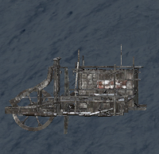

The Sawmill is used to turn raw wood  into processed wood . It needs to powered by the [generator](generator.md). Once the [generator](generator.md) is running, machine operators can place log inside the cabin and start processing the wooden log. Once the process starts, wooden log will go through the Sawmill and saw blade will cut it in half. This process also yields sawdust.

### Upgrades

The Sawmill has one [upgrade](Upgrades.md):

| Upgrade | Cost | Benefit |
| --- | --- | --- |
| Sharp Blade | 5 Processed Metal | Increases processed wood output from each log. |

With Sharp Blade installed, each log produces 4 wooden planks instead of 3. No other upgrade is required.