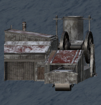

Steelworks is an infinite source of raw metal . Raw metal can be found on the pile near the entrance. Keep in mind that even though this is an infinite source of raw metal, it replenishes over time. Hence why you might not find raw metal at the pile at all times. 

To turn raw metal into ingots, switch on the Steelworks at its controls and process the metal at the mold. The Steelworks draws **one coal per minute** from the nearest [Resource Depot](Resource%20Depot.md) and stops smelting if it runs out of fuel.

This building also has a workbench for processing ingots and creating processed metal .