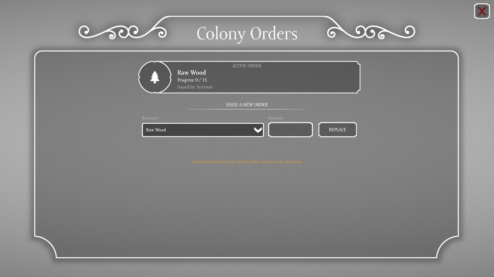

Colony Orders let the [governing faction](Voting.md) rally the whole colony around one gathering goal, such as "collect 500 coal".
While an order is active, everyone who gathers that resource in the colony earns bonus XP.

## Issuing an order

Only members of the governing faction can issue orders.

1. Press **O** to open the Colony Orders menu.
2. Pick a resource from the dropdown.
3. Enter the amount you want.
4. Press **Confirm**.

The top of the menu shows the current order: the resource, the progress and who issued it. If there is no order, it says "No active order".

- Only one order can be active at a time. Confirming a new order **replaces** the current one, and its progress is lost.
- Players who aren't in the governing faction can't issue orders.

## Taking part

- **Tracker:** while you're inside the colony, a small tracker on the right side of the screen shows the ordered resource and its progress (`collected / goal`). It's hidden when you leave the colony.
- **Bonus XP:** gathering the ordered resource **inside the colony** gives bonus XP. Gathering outside the colony gives normal XP.
- **Progress:** the goal only moves when you **deliver** the resource to a colony [depot](../Buildings/Resource Depot.md).
- Items taken out of a depot don't count again when you put them back.

## Completing an order

When deliveries reach the goal, the tracker shows **Completed** for a few seconds and then disappears.
The XP bonus ends, and the governing faction can issue a new order.
