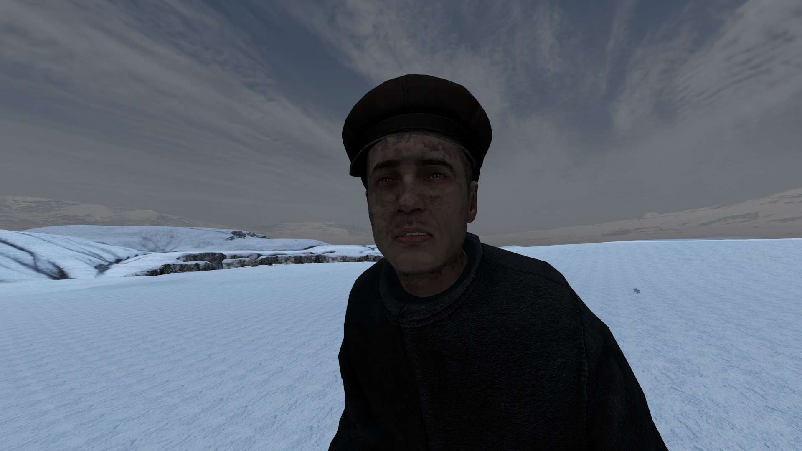

Living around the generator is anything else but a clean living space.
A running generator constantly pushes ash into the air.
Over time the player will get dirty which will be indicated visually on the players face and hands.

Being dirty makes you vulnerable against other infections and diseases.
Make sure to wash yourself using a bottle of water.
In order to wash yourself put the bottle in your hands and take off all clothing.
An action to wash yourself will appear.
Washing will drain your heatbuffer.