The heat level indicates the positive or negative temperature delta based on the overall temperature.  
It is indicated by a status badge indicator () on the player status hud the same way as vanilla status indicators are shown.

The added or subtracted heat level is shown as an additional badge indicator value on the status badge.

Each positive level provides enough heat to counter -10°C of environmental temperature.  
The heat level directly impacts the [heat buffer stat](Heat Buffer.md)

Bonus Tip: The environmental temperature and how it will change over time can be observed using the [beacon](../Buildings/beacon.md)